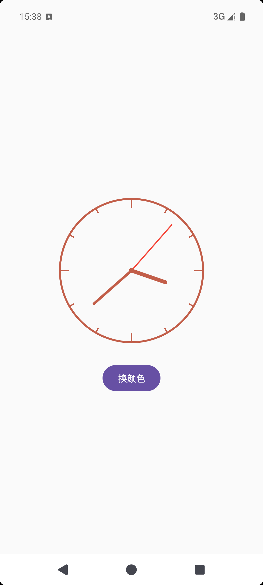

# AlphaClockView

一个轻量级的 Android 圆形时钟控件，支持自定义颜色和秒针显示，开箱即用。

## 特性

- 纯 Java 实现，无额外依赖
- 支持自定义时钟颜色
- 支持显示/隐藏秒针
- 自动跟随系统时间刷新
- 支持 XML 属性与代码 API 双配置

## 依赖

### 1. 在根目录 `settings.gradle.kts` 中添加 JitPack 仓库

```kotlin
dependencyResolutionManagement {
    repositories {
        google()
        mavenCentral()
        maven { url = uri("https://jitpack.io") }
    }
}
```

### 2. 在模块 `build.gradle.kts` 中添加依赖

```kotlin
dependencies {
    implementation("com.github.chenpeeer:AlphaClockView:v1.0.0")
}
```

## 使用

### XML 方式

```xml
<com.github.chenpeeer.alphaclockview.AlphaClockView
    android:layout_width="200dp"
    android:layout_height="200dp"
    app:alpha_clock_color="#2196F3"
    app:alpha_clock_show_second="true" />
```

### 代码方式

```java
AlphaClockView clock = findViewById(R.id.clock);
clock.setClockColor(Color.RED);
clock.setShowSecond(false);
```

## 属性说明

| 属性                        | 类型      | 默认值       | 说明           |
| ------------------------- | ------- | --------- | ------------ |
| `alpha_clock_color`       | color   | `#2196F3` | 时钟圆环、刻度和指针颜色 |
| `alpha_clock_show_second` | boolean | `true`    | 是否显示秒针       |

## 方法说明

| 方法                            | 说明       |
| ----------------------------- | -------- |
| `setClockColor(int color)`    | 设置时钟颜色   |
| `getClockColor()`             | 获取当前时钟颜色 |
| `setShowSecond(boolean show)` | 设置是否显示秒针 |
| `isShowSecond()`              | 获取是否显示秒针 |

## 最低版本要求

- `minSdk`：21（Android 5.0）
- `compileSdk`：35

## 截图



## License

MIT License


